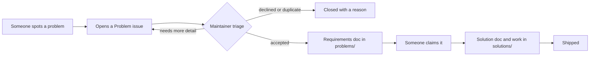

<!-- purpose: The front door of the hub: what it is, how a problem becomes a solution, and the two buttons a newcomer needs (submit a problem, take one up). -->

# Problems Worth Solving

**A public list of real problems, written up as clear requirements, for anyone who has the time and
skills to solve one.**

Most of us notice problems we'll never get around to fixing. Neighbours who can't get to appointments.
A form that takes three hours when it should take ten minutes. A service that exists but nobody can
find. This hub is where those problems get written down properly, so that someone who *can* help (a
volunteer group, a developer, a student, an organization) can pick one up and build the solution here,
in the open.

Solutions can be **social** (volunteering, a neighbourhood rota, a better process) or **technical**
(a web app, a mobile app, a tool), or both.

## How it works

1. **Submit a problem.** Fill in a short form. You don't need to know git.
2. **Triage.** A maintainer checks that the problem is real, affects a group of people, and is safe to
   work on in public. Accepted problems become a requirements doc in [`problems/`](problems/).
3. **Claim it.** Anyone who wants to build a solution says so. More than one approach to the same
   problem is welcome.
4. **Build it.** The solution gets its own folder in [`solutions/`](solutions/), starting with a
   `SOLUTION.md` that follows the [solution framework](CONTRIBUTING.md#the-solution-framework).
5. **Ship it**, and update the problem's status so the next person can find it.

## Get involved

| I want to… | Do this |
|---|---|
| **Submit a problem** | [Open a Problem issue](https://github.com/sirtthe9th/problems-worth-solving/issues/new?template=1-problem.yml) |
| **Talk through an idea that isn't ready yet** | [Start a discussion](https://github.com/sirtthe9th/problems-worth-solving/discussions) |
| **Browse problems** | [`problems/`](problems/) |
| **See what's being built** | [`solutions/`](solutions/) |
| **Build a solution** | [Claim a problem](https://github.com/sirtthe9th/problems-worth-solving/issues/new?template=2-claim.yml), then follow [CONTRIBUTING.md](CONTRIBUTING.md) |
| **Report abuse or a scam** | See [SAFETY.md](SAFETY.md) |

## The ground rules

- **Describe problems, not people.** No names, addresses or personal details of private individuals.
- **The hub never handles money.** No fundraising links or payment requests, in problems or solutions.
- **Keep coordination public.** No "message me privately to get involved."
- **Facts or blanks.** Every claim cites a source or is marked `[to confirm]`.

The full rules are in [SAFETY.md](SAFETY.md), [CODE_OF_CONDUCT.md](CODE_OF_CONDUCT.md) and
[GOVERNANCE.md](GOVERNANCE.md).

## License

- **Written content** (problem docs, solution docs, templates, these guides) is licensed under
  [CC BY 4.0](LICENSE-docs). Reuse it anywhere, with credit.
- **Code** (scripts, workflows, and source code inside `solutions/`) is licensed under [MIT](LICENSE).

By contributing, you agree your contribution is licensed the same way.
